<p align="center">
  
</p>

### Merhaba, ben Demet.

Dil modellerini gerçek veriyle çalışan, ölçülebilir sistemlere dönüştürmeye odaklanan bir yapay zeka mühendisiyim. RAG mimarileri, ajan akışları ve Türkçe doğal dil işleme üzerine çalışıyorum.

<br/>

### Biraz daha

```python
class Demet:
    name = "Demet Aşgaroğlu"
    role = "AI Engineer"

    education = {
        "lisans": "Yazılım Mühendisliği",
        "yuksek_lisans": "Bilgisayar Mühendisliği (tezli, devam ediyor)",
    }

    community = "Türkiye Yapay Zeka Topluluğu - Community Lead"

    ask_me_about = [
        "RAG mimarileri",
        "LLM ajanları ve araç kullanımı",
        "Türkçe NLP",
        "Metin sınıflandırma ve konu modelleme",
        "Model değerlendirme",
    ]

    stack = {
        "llm": ["LangChain", "LangGraph", "FAISS", "Gemini"],
        "ml": ["scikit-learn", "TensorFlow", "Keras"],
        "data": ["Pandas", "NumPy", "Spark", "Dask", "SQLite"],
        "backend": ["FastAPI", "Streamlit", "Docker"],
    }

    current_focus = "Ajan tabanlı RAG sistemleri ve bunların değerlendirilmesi"
```

<br/>

### Kullandığım teknolojiler

<p>
  
  
  
  
  
  
  
  
  
  
  
  
  
  
  
  
</p>

<br/>

### Bana ulaşın

<p>
  <a href="mailto:dasgaroglu@gmail.com"></a>
</p>
